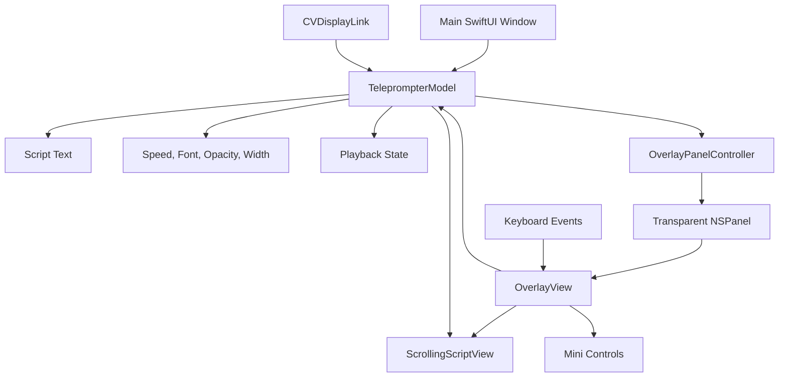

# Notch Teleprompter

A small macOS teleprompter that floats near the MacBook notch so you can read while staying close to the camera.

It was built for founder videos, demos, pitch recordings, and any situation where looking slightly below the webcam matters more than having a large studio teleprompter.

## Features

- Floating always-on-top overlay
- Top-center placement near the MacBook notch
- Dark translucent background with opacity control
- Smooth upward script scrolling
- Adjustable scroll speed, font size, width, and notch offset
- Paste-anything script editor
- Start, pause, reset, and close controls
- Optional mirrored text
- Optional hidden controls for cleaner recordings
- Speaker-aware speed mode for multi-person scripts
- No backend, no accounts, no external runtime

## How It Works



The app uses a normal SwiftUI window for editing and settings. When the overlay opens, an `NSPanel` is placed near the top-center of the main screen. `CVDisplayLink` drives smooth scrolling, while the SwiftUI model keeps speed, font, opacity, and playback state in sync.

## Requirements

- macOS 13 or newer
- Xcode 15 or newer recommended
- Swift 5.10 compatible toolchain

## Run Locally

```bash
git clone https://github.com/codewithriza/notch-teleprompter-macos.git
cd notch-teleprompter-macos
open Package.swift
```

Then choose the `NotchTeleprompter` target in Xcode and press Run.

You can also build from the command line:

```bash
swift build
```

## Usage

1. Paste your script into the editor.
2. Click `Start Teleprompter`.
3. Press `Space` or click `Start Scroll`.
4. Adjust speed, font, width, opacity, and notch offset until it feels natural.
5. Hide overlay controls before recording if you want a cleaner look.

## Keyboard Controls

| Key | Action |
| --- | --- |
| `Space` | Pause or resume |
| `Up Arrow` | Increase speed slightly |
| `Down Arrow` | Decrease speed slightly |
| `Shift + Up Arrow` | Increase speed more |
| `Shift + Down Arrow` | Decrease speed more |
| `1`, `2`, `3`, `4` | Jump to speed presets |
| `Cmd + +` | Increase font size |
| `Cmd + -` | Decrease font size |
| `Esc` | Close overlay |

## Speaker-Aware Speed

Multi-person scripts can use speaker tags like:

```text
[FOUNDER]
First section...
[COFOUNDER]
Second section...
```

When `Auto Speaker Speed` is enabled, the app keeps the base speed for `[FOUNDER]` sections and applies the multiplier to other speaker sections. This is useful when one reader needs a slower pace and the rest of the script can move faster.

## Project Structure

```text
.
├── Package.swift
├── README.md
└── Sources
    └── NotchTeleprompter
        ├── MainView.swift
        ├── NotchTeleprompterApp.swift
        ├── OverlayPanelController.swift
        ├── OverlayView.swift
        └── TeleprompterModel.swift
```

## Permissions

The app itself does not need camera or microphone access. Your recording app, such as Zoom, QuickTime, or Screen Studio, may still ask for its own camera, microphone, or screen recording permissions.

## Notes

Keyboard controls work when the overlay or app has focus. If another app owns keyboard focus during recording, use the on-screen controls or adjust the speed before starting the take.
